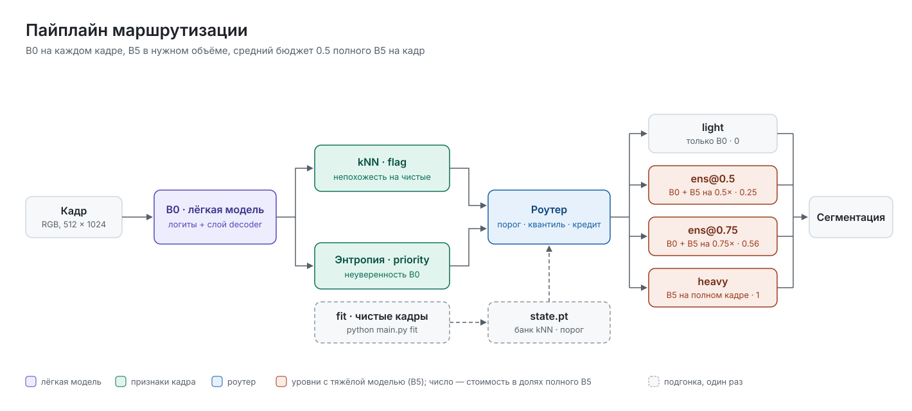

# error-geometry-routing

Сегментация потока кадров с маршрутизацией вычислений: лёгкая модель (SegFormer-B0) работает на каждом кадре,
а тяжёлая (SegFormer-B5) подключается в разном объёме только там, где она нужна, в пределах среднего бюджета.

## Пайплайн



Подробнее: [признаки кадра](docs/figures/02_features.svg), [решение роутера](docs/figures/03_router.svg),
[кредит бюджета](docs/figures/04_credit.svg). Схемы — SVG с живым текстом и именованными группами; в Figma
их можно вставить напрямую (перетащить файл или вставить содержимое), шрифт — Inter.

```
кадр ──► лёгкая модель (B0) ──► логиты + перехваченные слои (taps)
                                    │
                                    ▼
                         признаки кадра (features)        flag:     knn     — «кадр не похож на чистые данные»
                                    │                     priority: entropy — «B0 не уверена»
                                    ▼
                         роутер (router.py) ──► уровень: light | ens@0.5 | ens@0.75 | heavy
                                    │
                                    ▼
                         тяжёлая модель (B5) нужного масштаба, если уровень не light
                                    │
                                    ▼
                         сегментация: B0, среднее вероятностей B0 и B5, или B5
```

### Уровни

| уровень | что запускается | стоимость (доля полного B5) |
|---|---|---|
| `light` | только B0 | 0 |
| `ens@0.5` | B0 + B5 на кадре 0.5×, среднее вероятностей | 0.25 |
| `ens@0.75` | B0 + B5 на кадре 0.75×, среднее вероятностей | 0.5625 |
| `heavy` | B5 на полном кадре | 1 |

### Правило роутера

Роутер не знает, какие признаки ему дают: он получает два числа на кадр, `flag` и `priority`.

1. **Отметка `flag`.** Если `flag` выше порога, кадр получает `ens@0.75`. Порог — квантиль `quantile` (0.95)
   оценок `flag` на чистых кадрах, считается при `fit`. Если бюджета не хватает, кадр получает `ens@0.5`,
   а если не хватает и на него, `light`.
2. **Повышение по `priority`.** Любой кадр, у которого `priority` в верхней доле последних `window` (50)
   кадров, повышается до `heavy`. Доля подстраивается под бюджет, оставшийся после отмеченных кадров.
3. **Кредит.** Каждый кадр добавляет `budget`, каждый уровень списывает свою стоимость. Повышение
   разрешено, только если кредита хватает (с допуском в один полный B5). Так средняя стоимость держится
   около `budget`.

С `flag: null` остаётся только шаг 2: маршрутизация «B0 или B5» по одному признаку.

### Подгонка (`fit`)

На чистых кадрах (`fit_set`, по умолчанию Cityscapes val, Франкфурт) B0 прогоняется дважды:

1. признаки накапливают кадры (`update`) и завершают подгонку (`finish`) — например, `knn` собирает банк из
   20 000 векторов признаков декодера;
2. считаются оценки `flag` на тех же кадрах, по ним ставится порог.

Результат сохраняется в `state.pt` вместе с настройками, от которых он зависит.

**Бюджет — это объём вычислений, а не задержка.** Стоимость уровня считается по числу пикселей входа B5. На
ноутбучной RTX 4060 при батче 1 время B5 почти не зависит от размера кадра (запуск ядер дороже вычислений),
поэтому реальная экономия времени там меньше расчётной. `python main.py evaluate` замеряет время отдельно.

## Использование

Данные: `data/cityscapes/{leftImg8bit,gtFine}/val/...` и `data/acdc/{rgb_anon,gt}/<условие>/val/...`
(корень задаётся ключом `data`).

```bash
pip install -r requirements.txt
python main.py fit                          # подгонка на fit_set, сохраняет state
python main.py evaluate                     # mIoU, стоимость и время на eval_sets
python main.py run "frames/*.png" masks/    # маски и levels.csv для своих кадров
python main.py evaluate --config other.yaml # другой конфиг
```

### Конфиг

Все настройки — в `config.yaml`; ключ, которого там нет, берёт значение по умолчанию из `Config` в
`pipeline.py`.

| ключ | по умолчанию | смысл |
|---|---|---|
| `light`, `heavy` | `segformer-b0`, `segformer-b5` | модели (см. `models/__init__.py`) |
| `flag` | `knn` | признак для отметки кадров → `ens@0.75`; `null` — без отметки |
| `priority` | `entropy` | признак для повышения до `heavy` |
| `budget` | 0.5 | средняя стоимость на кадр, доля полного B5 |
| `quantile` | 0.95 | квантиль порога `flag` на чистых кадрах |
| `window` | 50 | число последних кадров для квантиля `priority` |
| `data` | `data` | корень данных |
| `state` | `state.pt` | файл с подгонкой |
| `fit_set` | `cs_fit` | чистые кадры для подгонки |
| `eval_sets` | `cs_test`, `acdc_*` | наборы для `evaluate`, идут одним потоком |
| `results` | `results/evaluate.json` | куда `evaluate` пишет отчёт |
| `shuffle` | `null` | seed для перемешивания потока; `null` — наборы друг за другом |
| `warmup`, `limit` | 5, `null` | кадры на прогрев; кадров на набор (для быстрой проверки) |

`state.pt` помнит модели, признаки и квантиль, с которыми делалась подгонка. Если в конфиге они другие,
`evaluate` и `run` попросят заново выполнить `fit`. Бюджет и окно можно менять без новой подгонки.

Наборы для `fit_set` и `eval_sets`: `cs_fit` (val, Франкфурт), `cs_test` (val, Линдау и Мюнстер), `cs_val`,
`acdc_<fog|night|rain|snow>`. Суффикс `:fog1`, `:dark2`, `:blur1`, `:noise2` и т. п. добавляет синтетическое
искажение, glob вроде `frames/*.png` даёт свои кадры без разметки.

### Из Python

```python
from loaders import get
from pipeline import Config, Pipeline

cfg = Config.load()            # config.yaml или значения по умолчанию
pipe = Pipeline(cfg)
pipe.fit(get(cfg.fit_set, cfg.data))
pipe.save()

pipe = Pipeline.load(cfg)
result = pipe(image)           # image: float [0, 1] tensor (3, H, W); кадры одного потока — по порядку
result.pred                    # (H, W) uint8, номера классов
result.level                   # выбранный уровень
result.scores, result.times    # оценки признаков; время этапов, мс
```

## Как добавить свой признак

Признак — `nn.Module`, который по выходу лёгкой модели на одном кадре возвращает одно число: чем больше,
тем нужнее тяжёлая модель.

**Что признак получает.** `forward(out)` вызывается с `out` — результатом лёгкой модели на одном кадре
(`models/common.py`):
- `out.logits` — логиты, (1, C, h, w), float32;
- `out.taps[имя]` — входы внутренних слоёв, которые признак запросил в `taps`. У SegFormer есть точка
  `"decoder"`: признаки декодера, (1, 256, H/4, W/4). Вместо имени точки можно указать путь модуля внутри
  модели, например `"net.segformer.encoder.block.3"`.

**Что признак возвращает.** 0-мерный тензор.

**Подгонка (необязательно).** Если признаку нужна статистика чистых кадров, он накапливает её в
`update(out)` (вызывается на каждом кадре `fit_set`) и завершает в `finish()`. Подогнанные тензоры храните
в буферах (`register_buffer`): они сами сохраняются в `state.pt`, загружаются и переезжают на видеокарту.

### Шаги

1. Создайте файл `features/<имя>.py` с классом-наследником `Feature`.
2. Добавьте импорт и строку в словарь `FEATURES` в `features/__init__.py`.
3. Укажите имя в конфиге: `flag: <имя>` или `priority: <имя>`.
4. Выполните `python main.py fit`, затем `python main.py evaluate`.

### Пример без подгонки: максимальная вероятность

```python
# features/msp.py
from features.base import Feature


class MSP(Feature):
    """1 − средняя максимальная вероятность B0: больше = B0 менее уверена."""

    def forward(self, out):
        return 1 - out.logits[0].softmax(0).max(0).values.mean()
```

### Пример с подгонкой: расстояние до среднего признака

```python
# features/mean_distance.py
import torch
import torch.nn.functional as F

from features.base import Feature


class MeanDistance(Feature):
    """Косинусное расстояние среднего признака декодера кадра до среднего по чистым кадрам."""
    taps = ("decoder",)

    def __init__(self):
        super().__init__()
        self.register_buffer("mean", torch.zeros(256))
        self.sum, self.count = 0, 0

    def update(self, out):
        self.sum = self.sum + out.taps["decoder"][0].float().mean((1, 2))
        self.count += 1

    def finish(self):
        self.mean = self.sum / self.count

    def forward(self, out):
        f = out.taps["decoder"][0].float().mean((1, 2))
        return 1 - F.cosine_similarity(f, self.mean, dim=0)
```

```python
# features/__init__.py
from features.entropy import Entropy
from features.knn import KNN
from features.mean_distance import MeanDistance
from features.msp import MSP

FEATURES = {"entropy": Entropy, "knn": KNN, "mean_distance": MeanDistance, "msp": MSP}
```

Если размер буфера заранее неизвестен (как банк в `knn`), посмотрите `features/knn.py`: буфер создаётся
пустым, а хук перед `load_state_dict` задаёт ему размер из файла.

## Как добавить свою модель

Модель — `nn.Module` с таким `forward`:

```python
forward(images, scale=1.0, taps=()) -> Out
```

- **`images`** — картинки в `[0, 1]`, (B, 3, H, W). Нормализацию под свою сеть модель делает сама.
- **`scale`** — во сколько раз уменьшить кадр перед прогоном. Нужно тяжёлой модели для уровней `ens@0.5` и
  `ens@0.75`.
- **`taps`** — имена слоёв, входы которых нужно вернуть. Модель объявляет свои точки в словаре `TAPS`
  (имя → путь модуля); `capture` из `models/common.py` вешает и снимает хуки.
- **Возвращает `Out(logits, taps)`.** Логиты во float32 в любом разрешении: пайплайн сам приводит их к
  размеру логитов лёгкой модели и к размеру кадра.
- **`num_classes`** — число классов. У лёгкой и тяжёлой модели оно должно совпадать, и классы должны идти в
  одном порядке (сейчас — 19 классов Cityscapes).

Чтобы признаки вроде `knn` работали с новой лёгкой моделью, объявите у неё точку `"decoder"` на слой с
плотными признаками. Если такой точки нет, признак упадёт с понятной ошибкой `get_submodule`.

### Шаги

1. Создайте файл `models/<имя>.py` с классом модели.
2. Добавьте ветку в `load_model` в `models/__init__.py`.
3. Укажите имя в конфиге: `light: <имя>` или `heavy: <имя>`.
4. Выполните `python main.py fit` (подгонка признаков зависит от лёгкой модели), затем `evaluate`.

### Пример: модель из Hugging Face

```python
# models/upernet.py
import torch.nn.functional as F
from torch import nn
from torchvision.transforms.v2 import functional as TF
from transformers import UperNetForSemanticSegmentation

from models.common import Out, capture


class UperNet(nn.Module):
    """UperNet, обученный на Cityscapes (чекпоинт — пример)."""
    TAPS = {"decoder": "net.decode_head.classifier"}   # вход классификатора — плотные признаки декодера
    MEAN, STD = [0.485, 0.456, 0.406], [0.229, 0.224, 0.225]
    num_classes = 19

    def __init__(self, checkpoint):
        super().__init__()
        self.net = UperNetForSemanticSegmentation.from_pretrained(checkpoint)

    def forward(self, images, scale=1.0, taps=()):
        p = next(self.parameters())
        x = images.to(p.device)
        if scale != 1.0:
            x = F.interpolate(x, scale_factor=scale, mode="bilinear", antialias=True)
        with capture(self, taps, self.TAPS) as captured:
            logits = self.net(pixel_values=TF.normalize(x, self.MEAN, self.STD).to(p.dtype)).logits.float()
        return Out(logits, captured)
```

```python
# models/__init__.py
from models.segformer import SegFormer
from models.upernet import UperNet


def load_model(name, device="cuda"):
    if name.startswith("segformer-"):
        model = SegFormer(name.removeprefix("segformer-"))
    elif name == "upernet-convnext":
        model = UperNet("<чекпоинт на Cityscapes>")
    else:
        raise KeyError(f"unknown model {name!r}")
    return model.to(device).eval().half()
```

## Результаты

### Пайплайн в потоке

`python main.py evaluate`, Cityscapes test + ACDC (fog, night, rain, snow), 639 кадров, `budget: 0.5`.
Сравнение с тем же роутером без отметки kNN (`flag: null`): только энтропия, «B0 или B5».

Разница «kNN + энтропия − только энтропия», парный бутстреп по кадрам (`python main.py compare`), 95% интервал:

| порядок кадров | mIoU (kNN / энтропия) | Δ mIoU | Δ % разрыва B0 → B5 | стоимость (kNN / энтропия) |
|---|---|---|---|---|
| наборы друг за другом | 64.06 / 62.53 | **+1.52 [+0.28, +2.80]** | **+17.0 [+3.3, +30.9]** | 0.46 / 0.43 |
| перемешан, seed 0 | 63.61 / 62.91 | +0.70 [−0.25, +1.73] | +7.8 [−3.1, +19.5] | 0.44 / 0.46 |
| перемешан, seed 1 | 64.08 / 63.59 | +0.49 [−0.13, +1.17] | +5.5 [−1.4, +14.0] | 0.44 / 0.46 |
| перемешан, seed 2 | 63.57 / 63.56 | +0.01 [−0.84, +0.91] | +0.1 [−9.8, +10.5] | 0.44 / 0.46 |
| перемешан, seed 3 | 63.81 / 63.33 | +0.48 [−0.71, +1.64] | +5.4 [−8.3, +17.6] | 0.43 / 0.46 |
| перемешан, seed 4 | 63.66 / 62.84 | +0.82 [−0.30, +2.19] | +9.1 [−3.5, +23.4] | 0.44 / 0.46 |

B0 — 57.14 mIoU, B5 на каждом кадре — 66.09.

- Когда условия меняются блоками (реалистично: погода и время суток меняются не каждый кадр), выигрыш kNN
  значим: +1.5 mIoU.
- В перемешанном потоке выигрыш меньше и по отдельности не значим, но на всех пяти порядках не ниже нуля
  (в среднем +0.5 mIoU, +5.6 п.п.), при этом kNN тратит немного меньше бюджета.
- По условиям: ночь и туман выигрывают, дождь в перемешанном потоке чаще проигрывает (−1…−2 mIoU): отмеченные
  kNN кадры дождя получают `ens@0.75`, а маршрутизация по энтропии чаще отдаёт их полному B5. На чистом
  Cityscapes разницы нет.
- Обе версии тратят меньше бюджета, чем `budget`: неиспользованный кредит выше потолка сгорает.

### Офлайн-исследование

Правило выбрано и проверено в ветке `baseline-experiments` (`experiments/`, эксперименты E10–E11) на кэшах
предсказаний, бюджет 0.5, % закрытого разрыва B0 → B5. Бюджет там распределялся офлайн, по всей выборке
сразу:

| набор | только энтропия | пайплайн | разница, 95% ДИ |
|---|---|---|---|
| Cityscapes test + ACDC, 639 кадров | 77.3 | 81.9 | +4.6 [+0.2, +10.2] |
| Cityscapes test × 8 искажений, 1864 кадра | 76.1 | 91.1 | +15.0 [+11.8, +18.9] |

mIoU на пуле Cityscapes test + ACDC: B0 57.2, пайплайн 64.5, B5 66.1. На чистых данных пайплайн почти совпадает
с маршрутизацией по энтропии; при бюджете 0.7 и выше выигрыша нет.

## Структура

```
config.yaml  настройки
main.py      командная строка: fit, evaluate (mIoU, стоимость, время), run
pipeline.py  Config и сборка: лёгкая модель → признаки → роутер → тяжёлая модель
router.py    уровни, правило и кредит бюджета
loaders.py   наборы данных: Cityscapes, ACDC, картинки по glob, синтетические искажения
models/      модели, файл на модель: segformer.py (B0/B2/B5); common.py — общий выход и хуки
features/    признаки, файл на признак: entropy.py, knn.py; base.py — базовый класс
docs/figures схемы пайплайна (SVG)
```
