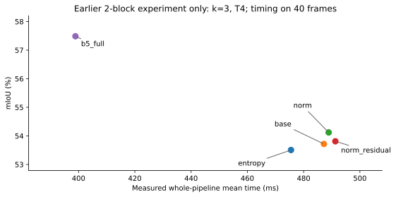
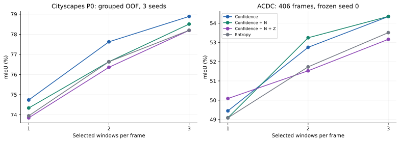
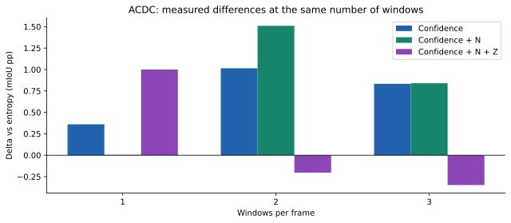
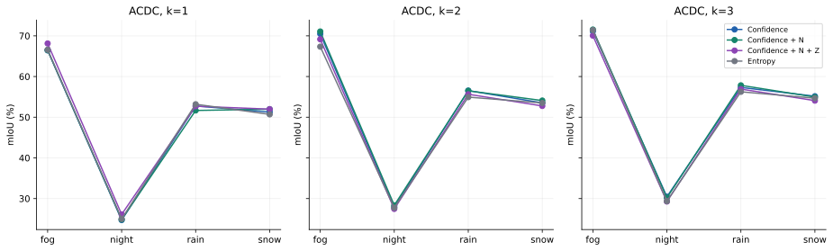
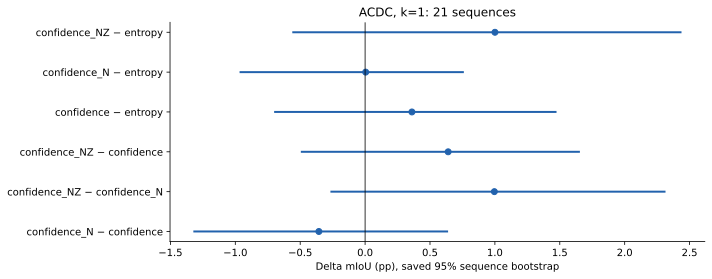
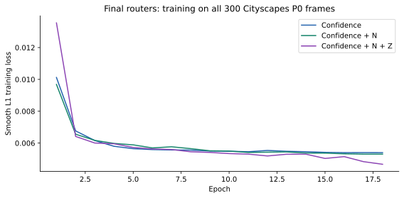

# Эксперименты: роутинг, внутренние представления и AE

**Дата отчёта: 29 октября 2026.** Задача — предсказывать по лёгкой модели, где тяжёлая модель исправит её ошибки, и выбирать дополнительные вычисления. Основные наборы — Cityscapes и ACDC (fog/night/rain/snow). Готовые сегментаторы глобально не дообучались.

**Итог серии:** реализован обучаемый оконный роутер пользы B5 и интеграция N/Z восьми готовых AE. В последней серии Cityscapes выбрал `confidence`; на ACDC лучшие точечные результаты при k=1/2/3 — соответственно `confidence_NZ`, `confidence_N`, `confidence_N`. Числа ниже относятся к разным протоколам: результаты B0/B2, раннего B0/B5 и нового all-block не смешиваются.

## 1. Карта выполненных опытов

| Опыт | Что проверяли | Результат | Решение |
|---|---|---|---|
| B0/B2: entropy vs F2/F3 head | Предсказывают ли активации пользу B2 лучше уверенности | P1: +0.212 / −0.195 п.п. при малом/основном бюджете | Сохранён энтропийный контроль |
| B0/B2: Euclidean / Mahalanobis | Даёт ли геометрия активаций пользу компонентному ridge | F3 Mahalanobis +0.571 на val, −0.117 к ridge на P1 | Выигрыш val не перенёсся |
| Error head BCE | Находят ли активации ошибки B0 | AP entropy 0.43445; activations 0.27549; both 0.41091 | Обнаружение ошибок отделено от пользы тяжёлой модели |
| Совместный узкий sparse AE | Код и reconstruction residual для BCE-головы | AP 0.42800; routing 75.374 при 2.4 против entropy 75.744 | AE не улучшил контроль |
| BatchTopK SAE + gain | Коды F2/F3/F4 и геометрия для ridge/XGBoost | Лучший confidence_gain ridge 76.286; SAE-комбинации ниже | Сохранён confidence_gain |
| E8/E8b | Можно ли заморозить контекст B5 | Восстановление настоящего выхода вне регионов подняло качество | Разделены ошибки контекста и выхода |
| E9, E8c, E9-k4 | Предсказанные состояния B5 и несколько контекстов | Настоящие четыре состояния +0.534/+0.498 к одному mid | Обучен многовыходный адаптер |
| E12 | Согласование адаптера через выход замороженной B5 | Подготовлены обучение/перенос; финальных E12-чисел в этом архиве нет | Не включать плановые числа в финальные метрики |
| Старый SpatialRouter + N/R | Нормы и AE residual двух блоков | ACDC k3: N +0.403 к base, +0.614 к entropy | Зафиксирован отдельный результат N |
| Новый all-block N/Z | Прямая интеграция восьми AE в gain-роутер | Полные CS CV и ACDC 406 кадров; таблицы ниже | База confidence, N/Z — выполненные абляции |
| Готовые CatBoost Z/R/ZR → main | Интеграция по SAE/INTEGRATION.md | Ноутбук подготовлен, итогового запуска в архиве нет | Следующий отдельный опыт |

Источники: последняя серия — приложенный `allblock_gain_router_acdc_final.zip`, побайтово сохранённый код и метрики в этой папке. Ранние числа — зафиксированные выводы запусков в истории проекта; они помечены историческими, их per-frame кэши в этот архив не входят. Связанные ветки: [B0/B2](https://github.com/Ottobiss/error-geometry-routing/tree/experiments/frozen-router-results-20261025), [error heads](https://github.com/Ottobiss/error-geometry-routing/tree/experiments/frozen-sae-errors-20261026), [адаптеры](https://github.com/Ottobiss/error-geometry-routing/tree/experiments/frozen-context-adapter-20261027), [ранний SpatialRouter](https://github.com/Ottobiss/error-geometry-routing/tree/results/spatial-router-acdc-20261028).

## 2. B0/B2: регрессия пользы и явная геометрия

Все 500 изображений — официальный Cityscapes val, внутреннее разбиение 240/60/200 для train/validation/P1. P1 — имя подвыборки из 200 кадров, не официальный test. Выходы стадий B0: F2 64×64×128, F3 160×32×64, F4 256×16×32; декодер C 256×128×256. Числа здесь — каналы × высота × ширина. Эти выходы стадий отличаются от FFN-активаций в последнем опыте.

Цель: +1 если B2 исправила B0, −1 если испортила правильный ответ, 0 иначе; затем агрегация в компоненты/карты. Головы по энтропии и F2/F3 обучались MSE пять эпох. Для окон 256×256 использовалась B2 с контекстом. Порог выбирался по validation, затем фиксировался.

| Метод | P1 окон/кадр | mIoU | Среднее мс | p95 мс |
|---|---:|---:|---:|---:|
| B0 | 0 | 71.569 | 38.959 | 39.702 |
| B2 full | — | 79.954 | 728.596 | 736.517 |
| entropy, малый бюджет | 0.975 | 76.471 | 175.097 | 454.569 |
| F2/F3 head, малый | 0.955 | 76.683 | 175.948 | 457.713 |
| entropy, основной | 2.735 | 79.901 | 416.299 | 725.800 |
| F2/F3 head, основной | 2.730 | 79.706 | 420.568 | 733.453 |

Отдельный ridge-контроль получал признаки уверенности/компоненты, а расширения — расстояния до классовых опор F2/F3: Euclidean и общий регуляризованный Mahalanobis.

| Метод | Val mIoU, 0.8 окна | Val mIoU, 2.4 окна | Δ к ridge при 2.4 |
|---|---:|---:|---:|
| ridge_base | 73.2675 | 75.6272 | 0 |
| Euclidean F2 | 73.0743 | 75.6970 | +0.0699 |
| Euclidean F3 | 73.0926 | 75.5690 | −0.0581 |
| Mahalanobis F2 | 73.0787 | 75.6776 | +0.0504 |
| Mahalanobis F3 | 73.1251 | 76.1982 | +0.5710 |

На P1 при зафиксированных порогах: ridge 79.7910, F3 Mahalanobis 79.6743, entropy 79.9009 mIoU. Повтор дал те же матрицы ошибок и число окон для всех 200 кадров. Время повтора: 462.829 / 967.399 / 380.960 мс соответственно. **+0.571 относится только к validation; в P1 геометрический финалист ниже обоих контролей.**

## 3. Обнаружение ошибки и первые AE

BCE-голова предсказывала долю ошибок B0 на ячейке общей сетки, а не исправление тяжёлой моделью. F2/F3 нормализовались и приводились к общей сетке; sigmoid-карта усреднялась в окнах для маршрутизации.

| Метод | Параметров | AP всех ошибок | AP уверенных внутренних ошибок | Val routing mIoU, 0.8 / 2.4 окна |
|---|---:|---:|---:|---:|
| entropy | 0 | 0.43445 | 0.07173 | 73.238 / 75.744 |
| confidence_bce | 2401 | 0.42945 | 0.06261 | 73.300 / 75.677 |
| activations_bce | 6481 | 0.27549 | 0.04795 | 72.858 / 75.576 |
| both_bce | 6529 | 0.41091 | 0.06055 | 72.453 / 75.261 |
| both_sparse_ae | 10081 | 0.42800 | 0.06730 | 72.517 / 75.374 |

Этот sparse AE: 224 объединённых каналов F2/F3 → Conv1×1 16 + ReLU → Conv1×1 224; совместная потеря BCE + 0.1 reconstruction MSE + 0.001 mean|z|. Он не равен поздним готовым восьми bottleneck AE.

Следующий SAE был BatchTopK: словарь 1536, бюджет активности 8, отдельные F2/F3/F4. Val L0 7.68 / 7.95 / 8.41; relative reconstruction error 2.081 / 0.742 / 0.605. На F2 ошибка восстановления превышала норму исходного сигнала по сохранённой метрике. В gain-роутинге при 2.4 окна:

| Признаки | XGBoost mIoU | Ridge mIoU |
|---|---:|---:|
| entropy | 75.74361 | 75.74361 |
| confidence | 76.19430 | 76.28625 |
| raw activations | 75.72763 | 76.19502 |
| SAE | 75.96617 | 76.16197 |
| confidence + SAE | 76.13188 | 76.16197 |
| SAE + geometry | 76.16751 | 76.16197 |
| confidence + SAE + geometry | 75.99542 | 76.16197 |

Добавление геометрии к SAE у XGBoost дало +0.20134 при 2.4 окна, но −0.86666 при 0.8. С confidence + SAE геометрия дала −0.13646 при 2.4. Контроль confidence остался выше SAE-вариантов. Эти результаты — только validation; P1 и время этой серии не измерялись.

## 4. Работа с контекстом B5

E8 обновлял выбранные токены stage 3, оставляя остальные на входном состоянии. Без восстановления настоящего выхода вне области качество падало. E8b разделил замороженный контекст и выход вне региона. E9 обучил адаптер B0→состояния B5, сами сегментаторы оставались замороженными.

На cs_test 233 кадра B0 имела 73.647362 mIoU. В E8c:

| Бюджет | Один настоящий mid | Четыре настоящих состояния | Полные тайлы B5 | Δ четыре − mid |
|---|---:|---:|---:|---:|
| 10% | 75.383037 | 75.916776 | 76.481198 | +0.533739 |
| 20% | 76.431929 | 76.929944 | 77.556035 | +0.498014 |

Per-block настоящие состояния воспроизвели полные тайлы: agreement 100%. Адаптер E9-k4 предсказывал состояния перед блоками 5/15/25/35 и final; его прирост к B0 составил +1.319/+2.679 п.п. Настоящие пять состояний давали примерно +2.740/+3.832. Это проверка подстановки состояний в teacher-assisted схеме, а не готовое ускорение.

План E12: старт с E9-k4; обучать только адаптер через итоговые логиты замороженной маскированной B5, KL внутри выбранных регионов плюс MSE состояний. В текущем архиве нет финального E12 отчёта. E11 — отдельная реализация реальных региональных вычислений — не следует считать выполненной на основании сценарных GOPs.

## 5. Первый SpatialRouter: нормы и residual

У предыдущей архитектуры использовались признаки уверенности, нормы N и остаток реконструкции R двух блоков. На ACDC при k=3:

| Метод | mIoU | Среднее мс | p95 мс |
|---|---:|---:|---:|
| entropy | 53.505973 | 475.509 | 513.128 |
| base | 53.717237 | 487.214 | 526.005 |
| norm | 54.120435 | 488.904 | 524.266 |
| norm_residual | 53.811583 | 491.274 | 527.200 |
| B5 full | 57.486238 | 398.888 | 435.673 |

Качество — на 406 кадрах; время — одинаковые 40 кадров, два повтора. N−base = +0.403198, N−entropy = +0.614462. Сохранённые интервалы по 21 последовательности: [+0.076707,+0.809265] и [−0.080679,+1.529281]. N не выполняет encode/decode AE; этот эффект относится к норме активаций. Полная B5 в этой серии одновременно быстрее и точнее всех k3 каскадов.

## 6. Последний опыт: SpatialRouter с восемью AE

Это отдельная архитектура с одинаковыми 548 входными каналами и нулевыми отключёнными каналами, пять GroupKFold, три seed, 18 эпох. Цель — польза окна B5. `confidence`: выходы B0; `confidence_N`: +12 норм; `confidence_NZ`: +512 кодов восьми AE. Полная спецификация в [PIPELINE.md](PIPELINE.md).

### 6.1 Cityscapes P0: среднее OOF mIoU по трём seed

| k | confidence | confidence_N | confidence_NZ | entropy |
|---:|---:|---:|---:|---:|
| 1 | 74.736531 | 74.337834 | 73.849400 | 73.949520 |
| 2 | 77.627178 | 76.637407 | 76.360328 | 76.636861 |
| 3 | 78.888313 | 78.508725 | 78.195116 | 78.199397 |

По основному k=1 выбран confidence. Добавление N/Z не увеличило средний OOF mIoU относительно confidence ни при одном k. `results/selection.json` не использует ACDC.

### 6.2 ACDC: общая матрица ошибок 406 кадров

| k | confidence | confidence_N | confidence_NZ | entropy |
|---:|---:|---:|---:|---:|
| 1 | 49.445501 | 49.089419 | **50.085328** | 49.084863 |
| 2 | 52.743134 | **53.238971** | 51.525469 | 51.728445 |
| 3 | 54.339221 | **54.346202** | 53.158076 | 53.505973 |

При одном окне NZ−entropy = +1.000464 п.п.; NZ−confidence = +0.639826; NZ−N = +0.995909. При двух и трёх окнах NZ ниже confidence на −1.217665 и −1.181145. Нормы при k2 дают +0.495837 к confidence и +1.510526 к entropy. При k3 разница N−confidence составляет +0.006981.

### 6.3 Результаты по погоде

Таблица всех 60 комбинаций и график показывают, как распределяется эффект. Числа здесь вычислены из сохранённых per-frame confusion matrices.

| domain | k | confidence | confidence_N | confidence_NZ | entropy |
|---|---|---|---|---|---|
| fog | 1 | 66.441658 | 66.480365 | 68.129260 | 66.589277 |
| fog | 2 | 70.481290 | 71.072921 | 69.154947 | 67.340537 |
| fog | 3 | 71.123317 | 71.544184 | 70.055170 | 71.435233 |
| night | 1 | 24.721804 | 24.857204 | 26.107112 | 25.007310 |
| night | 2 | 27.917743 | 28.338177 | 27.460171 | 27.736307 |
| night | 3 | 30.448640 | 30.195127 | 29.278865 | 29.350459 |
| rain | 1 | 52.752312 | 51.660695 | 52.700201 | 53.186736 |
| rain | 2 | 56.536432 | 56.491474 | 55.634858 | 54.932645 |
| rain | 3 | 57.315275 | 57.834416 | 56.905661 | 56.244368 |
| snow | 1 | 51.256233 | 51.969343 | 51.980275 | 50.699463 |
| snow | 2 | 53.519106 | 54.092069 | 52.767985 | 53.497034 |
| snow | 3 | 55.157588 | 54.949626 | 54.075484 | 54.671567 |

### 6.4 Сохранённые парные сравнения при k=1

| Сравнение | Δ mIoU, п.п. | Сохранённый 95% интервал |
|---|---:|---:|
| N − confidence | −0.356082 | [−1.315652; +0.631747] |
| NZ − N | +0.995909 | [−0.259473; +2.306898] |
| NZ − confidence | +0.639826 | [−0.487422; +1.647266] |
| confidence − entropy | +0.360638 | [−0.693179; +1.467181] |
| N − entropy | +0.004556 | [−0.959471; +0.753158] |
| NZ − entropy | +1.000464 | [−0.553360; +2.430093] |

Это парный bootstrap по 21 последовательности при фиксированных обученных моделях. Текущая ACDC оценка использует seed 0; в Cityscapes CV использованы три seed. В архиве все сравнения помечены exploratory и unadjusted. Таблица сохраняет исходные значения протокола без нового выбора лучшего метода по ACDC.

## 7. Что интегрировано из SAE

| Механизм | Реализован в последнем SpatialRouter | Что проверяет |
|---|---|---|
| Нормализация из восьми checkpoint | да | Согласованность масштаба активаций |
| N нормализованных FFN-активаций | да | Польза интенсивности внутреннего отклика |
| Z плотных AE-кодов | да | Польза сжатого внутреннего представления |
| R reconstruction residual | нет в последнем; был в старом опыте | Ошибка восстановления активаций |
| Готовые CatBoost R/Z/ZR | отдельный подготовленный ноутбук | Предсказание ошибки B0, затем кадровый flag |
| Дообучение B0/B5 | нет | Сегментаторы заморожены |

Интеграция N/Z выполнена, её результат измерен в финальных таблицах. Готовые CatBoost R/Z/ZR и прямые AE-коды — разные реализации. Положительные метрики обнаружения ошибки в ветке SAE не заменяют mIoU роутинга B5.

## 8. Основные выводы по фактам

1. Обучение непосредственно на пользе тяжёлой модели даёт работоспособный SpatialRouter. В последней Cityscapes CV confidence выше entropy при k=1/2/3 на +0.787011/+0.990317/+0.688916 п.п.
2. Восемь готовых AE интегрированы в оконный gain-роутер. На ACDC NZ даёт лучший результат при одном окне: 50.085328 mIoU, +1.000464 к entropy. При k2/k3 лучший AE-вариант — N без Z.
3. Коды Z не дали общего выигрыша по всем бюджетам. Базовым по исходному правилу остаётся confidence. Ранние Euclidean/Mahalanobis и sparse AE также не заменили уверенность как основной контроль.
4. Эффект норм активаций и эффект кодирования AE разделены. Старый результат +0.403 относится к N двухблочного роутера; новый результат +0.640 при k1 — к NZ против нового confidence.
5. Реальное ускорение последнего all-block каскада не измерено. Старый k3 каскад проиграл полнокадровой B5 по времени и mIoU. Для текущей версии бюджет k нельзя выдавать за ускорение.
6. Работа с несколькими контекстными состояниями улучшила сохранение качества B5. Перенос адаптера, E12 и реальные региональные вычисления требуют собственных завершённых таблиц; в финальные числа SpatialRouter они не включены.

## 9. Состав поставки и проверка

- `source/` — неизменённые скрипты фактического опыта и P0 IDs.
- `ae_b8/` — восемь готовых AE с нормализацией.
- `results/router_*.pt` — три финальных роутера с нормализацией и ссылками на SHA AE.
- `results/` — CSV, per-frame матрицы, OOF predictions, folds, протокол, истории и логи.
- `figures/` — новые графики SVG/PNG/PDF из сохранённых чисел.
- `reproduce_figures.py` — CPU-пересчёт, проверка и построение.
- `integration_reference/` — подготовленный отдельный ноутбук main + CatBoost Z/R/ZR, его scorer и вспомогательные диагностики.
- `SHA256SUMS.json` — контрольные суммы файлов поставки.

Текущий отчёт не запускал GPU повторно. Значения Cityscapes и ACDC проверены пересчётом из исходных матриц. Большие фотографии, GT и кэши признаков не включены; для повторной ACDC-оценки нужны изображения и GT. Все имеющиеся финальные веса и метрики включены.
