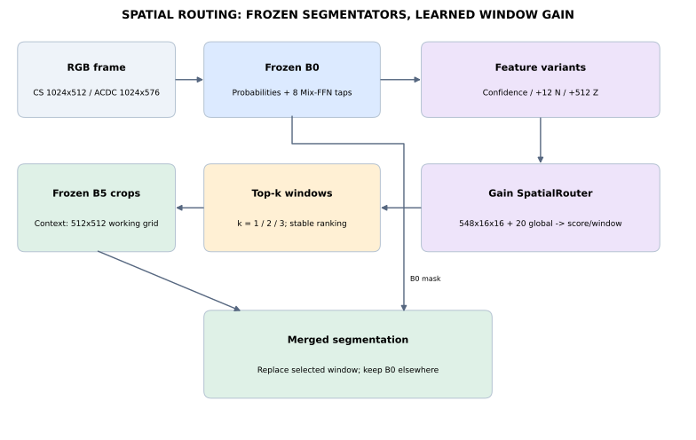
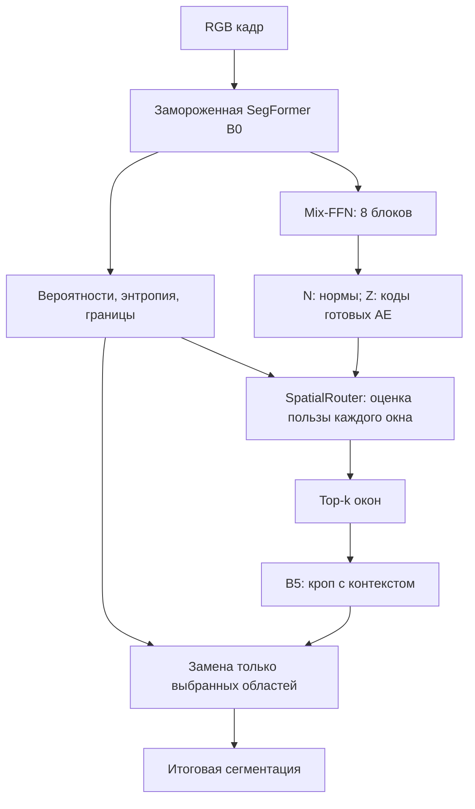

# SpatialRouter: базовый пайплайн и интеграция AE

**Состояние: 29 октября 2026.** Реализация и сохранённые веса находятся в этой папке. Проект: семантическая сегментация дорожных сцен, 19 классов Cityscapes, переключение B0 → B5 для отдельных областей. B0, B5 и готовые AE заморожены; обучается регрессор пользы окна.

**Базовый вариант для воспроизведения — `confidence`.** Он выбран по среднему OOF mIoU на Cityscapes при одном окне, до оценки ACDC (`results/selection.json`). `confidence_N` и `confidence_NZ` — реализованные расширения с внутренними представлениями. Все три финальных checkpoint входят в поставку. Результаты описаны в [EXPERIMENTS.md](EXPERIMENTS.md).





## 1. Модели и данные

| Объект | Значение |
|---|---|
| Лёгкий сегментатор | `nvidia/segformer-b0-finetuned-cityscapes-512-1024` |
| Тяжёлый сегментатор | `nvidia/segformer-b5-finetuned-cityscapes-1024-1024` |
| Пространство меток | trainId 0–18; ignore 255 |
| Рабочий кадр Cityscapes | ширина 1024 × высота 512 |
| Рабочий кадр ACDC | ширина 1024 × высота 576 |
| Нормализация RGB | ImageNet mean `[.485,.456,.406]`, std `[.229,.224,.225]` |
| Версии выполненного опыта | PyTorch 2.11.0+cu130; transformers 4.46.3 |
| Обучение роутера | 300 изображений P0 из официального Cityscapes val |
| Выбор настроек | 5 GroupKFold по `city+sequence`; seeds 0/1/2 |
| Финальная оценка | 406 ACDC val: fog 100, night 106, rain 100, snow 100 |

Идентификаторы Cityscapes — `source/p0_ids.txt`; точные train/val folds — `results/folds.json`; ACDC — `results/acdc_manifest.json`. Пути в manifest относятся к исходной Colab-среде. При переносе данные задаются через переменные окружения, маски и фотографии в git не включены.

## 2. Что получает роутер

Один forward B0 возвращает вероятности 19 классов. Они билинейно приводятся к рабочему размеру. Аргмакс даёт исходную сегментацию. Для каждого окна формируются 24 базовых канала:

- 19 вероятностей классов;
- энтропия `−Σ p log p`;
- разница двух максимальных вероятностей;
- карта границ предсказанного класса;
- нормализованные координаты x и y.

Каждое окно приводится к сетке 16×16. Дополнительно подаются 20 глобальных чисел: средние вероятности 19 классов по кадру и средняя энтропия. Это собственный базовый SpatialRouter; он отличается от скалярного кадрового роутера `main`.

## 3. Откуда берутся N и Z

Хуки перехватывают **вход `mlp.dense2` после GELU внутри Mix-FFN** каждого из восьми блоков энкодера B0. Это расширенные FFN-активации, а не обычные выходы стадий F2/F3 из ранних опытов. Для текущей transformers 4.46.3 путь имеет вид `segformer.encoder.block[s][j].mlp.dense2`.

| Стадия | Блоки | Stride | Размер активации d | Код каждого AE b |
|---|---|---:|---:|---:|
| 1 | s1b1/s1b2 | 4 | 128 | 16 |
| 2 | s2b1/s2b2 | 8 | 256 | 32 |
| 3 | s3b1/s3b2 | 16 | 640 | 80 |
| 4 | s4b1/s4b2 | 32 | 1024 | 128 |

Из checkpoint берутся вектор mean и скаляр scale. Для токена `h` вычисляется `x=(h−mean)/scale`.

**N** — средний квадрат нормализованной активации: `sum(x²)/d`. Это интенсивность внутреннего отклика, а не расстояние до прототипа класса. Для стадий 1–2 на патче 16×16 сохраняются mean и max; для стадий 3–4 берётся ближайший токен к центру патча. Получается 12 каналов N.

**Z** — подписанный плотный код готового bottleneck AE: `Linear(d,d) → GELU → Linear(d,d/8)`. Полный AE имеет декодер `Linear(d/8,d) → GELU → Linear(d,d)`. В данном роутере используется только кодирование. Коды ранних стадий усредняются в патче; поздние берутся по ближайшему токену. Суммарно 512 каналов Z. Восемь AE и их нормализация сохранены в `ae_b8/`.

Название ветки `SAE` относится к источнику готовых моделей. **Эти checkpoint — плотные bottleneck AE с signed-кодом, а не BatchTopK SAE.** Реконструкционный остаток R в текущий all-block роутер не подаётся.

Карты N/Z согласованы на общей сетке stride 16: 32×64 для Cityscapes и 36×64 для ACDC. Для окна соответствующая область карты ресайзится в 16×16. N преобразуется через log1p; N и Z стандартизуются по обучающей части fold. В финальном checkpoint статистики рассчитаны на всех 300 P0 кадрах.

## 4. Архитектура и контролируемое сравнение

| Вариант | Содержательные локальные входы | Прочие каналы |
|---|---|---|
| confidence | 24 базовых | 524 нуля |
| confidence_N | 24 базовых + 12 N | 512 нулей |
| confidence_NZ | 24 базовых + 12 N + 512 Z | отсутствуют |

Во всех вариантах одинаковая архитектура на 548 входных каналов:

`Conv1×1(548→32) → ReLU → Conv3×3(32→32,padding=1) → ReLU → AdaptiveAvgPool → 32 числа`.

К ним добавляются 20 глобальных чисел, затем `Linear(52→32) → ReLU → Linear(32→1)`. Выход — оценка пользы окна. Нулевые каналы позволяют сравнить признаки в общей архитектуре. Это не та же архитектура, что у предыдущего двухблочного `base`.

Цель обучения для окна:

`gain = (исправленные B5 пиксели − испорченные B5 пиксели) / 65536`.

Пиксели ignore=255 не учитываются. **Цель у окна, а не отдельного пикселя.** Исправление означает: B0 ошиблась, B5 в кропе дала GT; порча — обратный случай. Регрессия оптимизирует эту величину, итоговый mIoU считается отдельно.

18 фиксированных эпох, AdamW, lr 0.002, weight decay 0.0002, batch 128, SmoothL1 beta 0.02. Финальные модели обучены на всём P0 с seed 0. В ACDC ничего не дообучалось.

## 5. Выбор окон и запуск B5

Кадр делится на неперекрывающиеся окна до 256×256 рабочих пикселей. Cityscapes: 8 окон. ACDC: 12, включая нижние четыре окна высотой 64. По stable argsort выбираются k=1/2/3 максимальных оценок. Контроль `entropy` использует среднюю энтропию каждого окна без обучения.

Для каждого выбранного окна B5 получает контекстное окно 512×512 на рабочей сетке, то есть номинальный margin 128. Кроп сдвигается внутрь изображения у границ. В Cityscapes B5 видит соответствующий кроп 1024×1024 исходного изображения; в ACDC — кроп 512×512 рабочего изображения. Логиты B5 приводятся к 512×512. В итоговой маске заменяется **только выбранная область**, контекст не заменяет соседей.

При ACDC последняя строка окон меньше остальных. k — число запусков, не одинаковая площадь исправления и не измеренное время. Обработка B5 вне выбранных окон не требуется при реальном инференсе; скрипт оценки заранее считает все кропы для сравнения разных селекторов по одному кэшу.

## 6. Метрики

Матрицы ошибок суммируются по всем валидным пикселям выборки, затем вычисляется `IoU_c=TP/(TP+FP+FN)` и среднее по классам с ненулевым union. **ACDC all — mIoU из общей матрицы, не среднее четырёх погод и не среднее mIoU кадров.**

В архиве есть per-frame confusion matrices и bootstrap по последовательностям (2000 повторов, seed 0). Первичное сравнение: `confidence_NZ − confidence_N` при k=1. k=2/3 — дополнительные. ACDC повторно использовалась в проекте; текущий протокол помечает её как exploratory. Полное время all-block версии не измерялось.

Долю закрытого разрыва можно считать только при согласованных B0 и **полнокадровой** B5 на той же выборке:

`100 × (mIoU_pipeline − mIoU_B0) / (mIoU_B5_full − mIoU_B0)`.

Текущий архив не содержит эти две отдельные референсные маски для all-block ACDC. Поэтому эта метрика здесь не заполнена чужими B0/B5 из прошлой серии. Кроповая B5 и полнокадровая B5 — разные референсы.

## 7. Воспроизведение

Из этой папки, в окружении с CUDA-enabled torch и transformers 4.46.3:

```bash
pip install -r requirements-experiment.txt
export ALLBLOCK_ROOT="$PWD/runtime"
export ALLBLOCK_OUT="$PWD/results"
export ALLBLOCK_AE="$PWD/ae_b8"
export ALLBLOCK_CS="/path/to/cityscapes"
export ALLBLOCK_ACDC="/path/to/acdc"
python source/allblock_router.py acdc
```

Для повторного обучения используйте **новой пустой каталог** `ALLBLOCK_OUT` и последовательно `preflight`, `smoke`, `cache`, `cv`, `final`, `acdc`. `protocol.json` фиксирует SHA кода, версий и AE; менять его для обхода проверки не следует. `training_complete.json/acdc_run:false` — снимок этапа final; завершение последующей ACDC подтверждается отдельным `acdc_complete.json`.

Таблицы и графики из готовых результатов восстанавливаются на CPU:

```bash
pip install -r requirements-analysis.txt
python reproduce_figures.py
```

Скрипт проверяет CSV против матриц ошибок, создаёт class IoU, SVG/PNG/PDF и `results/report_validation.json`. Новое обучение или GPU для отчёта не нужны.

## 8. Как это соотносится с main Ottobiss

| Свойство | `main` на 8eb70ca | Этот SpatialRouter |
|---|---|---|
| Единица решения | кадр и масштаб B5 | окно изображения |
| Вход роутера | два скаляра flag/priority | пространственные карты и глобальные признаки |
| Бюджет | кредит по площади входа B5 | фиксированное k окон |
| Геометрия | kNN признаков декодера | N и коды Z Mix-FFN |
| Обучаемая цель | правило маршрутизации | исправлено минус испорчено |
| Выход | B0 / ансамбль / B5 | B0 с заменой выбранных окон |

Папка публикуется отдельным модулем в ветке `results/spatial-router-acdc-20261028`. Код кадрового baseline из main не переписывается; его `router.py`, `pipeline.py` и registry остаются отдельной реализацией. Сходство оформления не означает тождество алгоритмов. Числа main на 639 кадрах и числа этого ACDC на 406 кадрах не являются прямым сравнением методов.

Готовая интеграция SAE имеет два пути:

1. **Выполнено:** прямые N/Z из восьми AE → новая gain-голова SpatialRouter. Это именно опыт текущего архива.
2. **Подготовлено, финальных метрик нет:** готовые CatBoost Z/R/ZR из [SAE/INTEGRATION.md](https://github.com/Ottobiss/error-geometry-routing/blob/ed2b6f7a0496efef8e8bf911b8e5b04cab9aaf24/INTEGRATION.md) → score map → скаляр flag для кадрового baseline main. Ноутбук и скопированный scorer находятся в `integration_reference/`. Его окружение и API отличаются: HF 5.x, вход fc2; обязательна acceptance-проверка с scores.parquet, max error <1e-6. Это отдельный запуск, не результат таблиц SpatialRouter.

Готовый CatBoost предсказывает долю ошибок B0, а не пользу B5. Его готовые веса обучались на P0; при оценке кадрового baseline эти P0-кадры исключаются из Cityscapes test-пула. В ноутбуке остаются 92 Cityscapes + 406 ACDC. R/Z/ZR не объявляются победителями до завершения этого запуска.

## 9. Результат пайплайна

Базовый `confidence` обучен предсказывать реальную пользу B5 и выбран по Cityscapes. Кодирование готовыми AE интегрировано в `confidence_NZ`. На ACDC при k=1 оно даёт 50.085 mIoU; базовый confidence — 49.446, энтропия — 49.085. При k=2/3 NZ даёт меньше mIoU, чем confidence. Измеренные таблицы всех бюджетов и погод, исходные checkpoint и код сохранены. Следующая системная проверка — полный замер времени этой версии и сравнение с полнокадровым baseline на одном протоколе.
